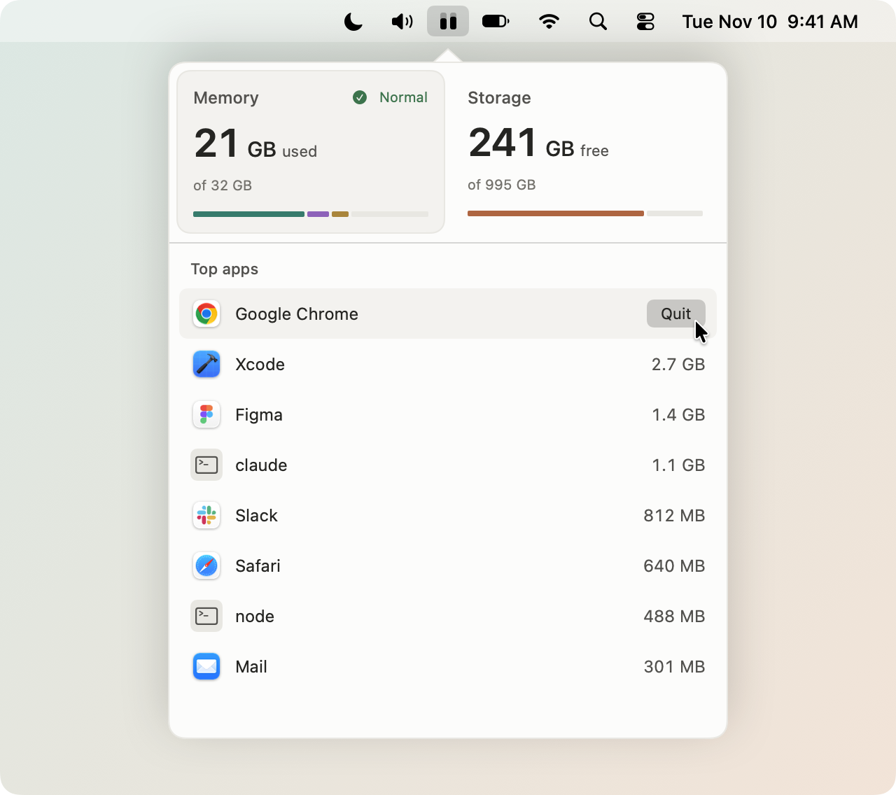

<p align="center"></p>

# gauge

A small macOS menu bar app that shows how much memory and disk you're using, and what's taking it up.

<p align="center">
  <picture>
    <source media="(prefers-color-scheme: dark)" srcset="docs/gauge-dark.png">
    
  </picture>
</p>

The icon is two bars - memory on the left, disk on the right. Memory turns orange or red when macOS reports memory pressure, disk turns red once it's over 90% full.

## Memory

- Used out of total, split into apps, wired and compressed, plus the pressure level
- Your top apps by memory. Helpers count toward their app and XPC services toward the app they work for, so Safari's tabs show up under Safari
- Command line tools like `node` or `claude` get their own row, with the command and the folder they're running in
- Click an app to switch to it. Hover a row to quit it, or right-click it to force quit. If it's still running 10 seconds after Quit, gauge force quits it - unless the app opened a window to ask you something, like Save changes?
- macOS's own processes are never offered

## Storage

- Free space out of total
- The biggest apps, files and folders (500 MB and up) in Applications and your home folder, with when you last opened them
- Show in Finder or Move to Trash, and empty the Trash from there

Right-click the icon for Activity Monitor, Storage Settings, Open at Login and Quit.

## How light it is

Measured on an M5 Pro with macOS 27.2, gauge sitting in the menu bar:

| | |
|---|---|
| Memory | 39 MB |
| CPU | 0.15% on average (0.18 s of CPU time in 2 minutes) |
| App size | 1.8 MB (480 KB to download), Apple silicon and Intel |
| Code | 874 lines of Swift, no dependencies |

- Memory and per-app numbers come straight from the kernel, no `ps` or `top` running in the background
- The icon updates every 5 seconds with a bit of slack so macOS can group the wakeups with others, and free disk space is only checked once a minute
- The window refreshes every 2 seconds only while it's open, and its views are thrown away when it closes
- The storage scan is one low priority `du` run that only reports things over 100 MB. It's saved to disk so it doesn't run again on every launch

## Install

Download [gauge.zip](https://github.com/thisisvaze/gauge/releases/latest/download/gauge.zip), unzip it and drag gauge.app to Applications. Runs on macOS 14 or later, Apple silicon and Intel.

### Build it yourself

Needs Xcode 26 (Swift 6.2).

```sh
git clone https://github.com/thisisvaze/gauge.git
cd gauge
./bundle.sh install
```

That builds a release, copies gauge.app to /Applications and opens it. `./bundle.sh` on its own just builds `build/gauge.app`, and `./bundle.sh release` makes the universal, notarized `build/gauge.zip` (set `NOTARY_PROFILE` first, see the top of the script).

### Full Disk Access

For a complete storage scan, give gauge Full Disk Access in System Settings > Privacy & Security (the app has a button that takes you there). When you build it yourself, `bundle.sh` signs with your Apple Development certificate if you have one, so the permission sticks across rebuilds. Without one it signs ad hoc, and you may have to allow it again after each build.

## Tests

```sh
swift test
```

## License

[MIT](LICENSE)
